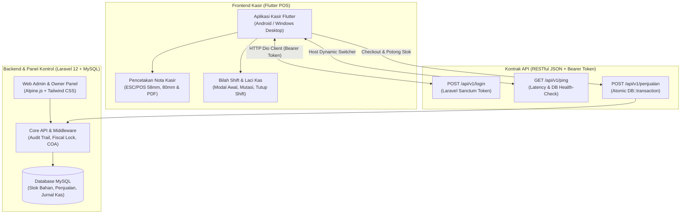

# Sistem Informasi Keuangan & Kasir POS Kedai Kopi (Full-Stack)

Sistem Point of Sale (POS) dan tata kelola finansial terpadu untuk kedai kopi dan retail modern. Dibangun menggunakan arsitektur *decoupled client-server* yang mengintegrasikan backend REST API **Laravel 12** dengan aplikasi kasir multi-platform **Flutter** (Android Mobile/Tablet & Windows Desktop) serta panel web administrasi berbasis **Alpine.js**.

---

## Arsitektur Terintegrasi & Alur Data

Sistem menghubungkan kasir di lini depan langsung dengan pembukuan dan kontrol manajerial di lini belakang melalui kontrak API real-time:



---

## Komponen Teknologi & Sinergi Sistem

| Lapisan | Komponen | Teknologi | Peran & Integrasi |
|---|---|---|---|
| **Client Kasir** | `mobile/` | Flutter 3, Dart, Dio Client, SharedPreferences | Antarmuka kasir cepat berdesain Swiss/Industrial, tiket pesanan real-time, manajemen shift laci kasir, dan pencetakan nota thermal. |
| **Backend API** | `backend/` | Laravel 12, PHP 8.2+, Laravel Sanctum | Pintu gerbang REST API v1, penerbit Bearer Token per sesi login, validasi transaksi atomik, dan kalkulasi mutasi stok bahan baku. |
| **Web Admin & Audit** | `backend/` | Blade, Alpine.js, Tailwind CSS | Dashboard operasional web, persetujuan opname selisih oleh Owner, pencatatan beban operasional (COA 5-1100), dan jejak audit enterprise. |
| **Penyimpanan Data**| Local / Server | MySQL 8.0+ | Penyimpanan relasional terisolasi untuk katalog varian menu, transaksi penjualan, riwayat belanja distributor, dan sesi kasir. |

---

## Fitur-Fitur Terintegrasi

### 1. Sinkronisasi Kasir (Flutter) & Backend (Laravel)
- **Otentikasi Sanctum Berbasis Sesi:** Kasir login dari aplikasi Flutter menggunakan akun kasir. Backend menerbitkan *Bearer Token* Sanctum yang disimpan di `SharedPreferences` perangkat mobile.
- **Konfigurasi Host Dinamis & Uji Latensi:** Tombol **Host API** pada form login Flutter memungkinkan kasir berpindah alamat server secara fleksibel (IP LAN Komputer, Cloudflare Tunnel, Android Emulator `10.0.2.2`, atau Server Cloud) disertai tombol **Tes Koneksi** yang memanggil endpoint `GET /api/v1/ping` untuk memverifikasi latensi milidetik server sebelum login.
- **Transaksi Penjualan Atomik:** Saat kasir menekan tombol bayar di Flutter, transaksi dikirimkan ke backend dan diproses di dalam blok `DB::transaction()`. Pengurangan stok bahan baku dan penambahan saldo buku kas terjadi seketika tanpa risiko inkonsistensi data.

### 2. Operasional Kasir & POS Fisik (Flutter Client)
- **Tiket Pesanan Real-Time (*Artisan Order Ticket*):** Pemilihan tipe pesanan (*Dine In* / *Take Away*), input nomor meja, pilihan varian (suhu, ukuran, kadar gula, es, topping), dan kalkulator hitung uang kembalian.
- **Manajemen Shift Terpadu (*Compact Ribbon*):** Pencatatan modal awal laci saat buka toko, mutasi kas masuk/keluar harian, dan rekonsiliasi selisih kas fisik saat tutup shift.
- **Pencetakan Struk Multi-Format:** Mendukung rol standar **80 mm (POS USB/PC)**, rol kecil **58 mm (Printer Mini Bluetooth)**, dan kertas **A4 / Simpan PDF** langsung melalui sistem cetak bawaan perangkat.

### 3. Kontrol Manajerial & Keuangan Korporat (Laravel Backend)
- **Stok Opname & Approval Owner:** Penyesuaian stok yang mengalami selisih fisik (rusak, hilang, susut) secara otomatis berstatus `menunggu_persetujuan` dan membutuhkan konfirmasi Owner sebelum stok sistem diperbarui.
- **Pencatatan Beban Operasional & Bukti Fisik:** Nomor voucher kas keluar otomatis (`BKK-YYYYMMDD-XXXXX`), pemetaan akun (*Chart of Accounts* COA `5-1100` s.d. `5-1900`), dan arsip lampiran berkas kuitansi (PDF/JPG).
- **Enterprise Audit Trail & Fiscal Lock:** Mencatat seluruh log mutasi belanja, perubahan harga, login staf beserta User-Agent, serta penguncian tanggal buku (*Fiscal Lock*) untuk mencegah transaksi manipulatif di masa lampau.

---

## Matriks Peran & Akun Uji Coba

| Peran | Saluran Akses | Wewenang Utama | Akun Bawaan Seeder |
|---|---|---|---|
| **Kasir** | Flutter App (Mobile/Desktop) & Web | Buka/tutup shift, transaksi POS, mutasi kas laci, cetak nota, antrean pesanan. | `kasir@example.com` / `password` |
| **Admin** | Web Dashboard | Master data menu & bahan, belanja distributor, input opname stok, catat beban operasional, monitoring shift kasir. | `admin@example.com` / `password` |
| **Owner** | Web Dashboard | Hak penuh: persetujuan selisih stok, ubah/hapus beban, voucher diskon, pembatalan transaksi, dan laporan finansial komprehensif. | `owner@example.com` / `password` |

---

## Panduan Instalasi & Menjalankan Sistem

### Persyaratan Sistem
- PHP >= 8.2 & Composer >= 2.x
- MySQL Database
- Flutter SDK >= 3.x

---

### Tahap 1: Setup Backend Laravel API

```bash
cd backend

# Salin konfigurasi environment dan instal paket
cp .env.example .env
composer install

# Generate application key
php artisan key:generate

# Konfigurasikan koneksi basis data di berkas .env:
# DB_DATABASE=sistem_keuangan
# DB_USERNAME=root
# DB_PASSWORD=

# Eksekusi migrasi tabel dan seeder data awal
php artisan migrate --seed

# Jalankan server API (bisa diakses oleh HP/komputer di jaringan LAN yang sama)
php artisan serve --host=0.0.0.0 --port=8000
```

> **Akses Cepat (Windows):** Klik ganda berkas `backend/jalankan-server.bat`. Skrip otomatis mendeteksi IP lokal komputer Anda dan menjalankan backend pada port `8000`.

---

### Tahap 2: Menghubungkan Frontend Flutter

```bash
cd mobile

# Unduh dependensi aplikasi Flutter
flutter pub get

# Jalankan aplikasi kasir pada perangkat yang diinginkan
flutter run
```

#### Menghubungkan Aplikasi ke Server:
1. Buka aplikasi di perangkat (HP / Desktop / Emulator).
2. Pada layar login, klik tombol **Host API** di bagian bawah.
3. Masukkan alamat server backend:
   - **Emulator Android:** `http://10.0.2.2:8000`
   - **HP Fisik (Wi-Fi LAN sama):** `http://<IP-Komputer-Anda>:8000` (contoh: `http://192.168.1.15:8000`)
   - **Akses Luar Jaringan:** Gunakan URL Cloudflare Tunnel dari `backend/jalankan-tunnel.bat`.
4. Klik **Tes Koneksi** untuk memastikan status database menyala, lalu simpan.
5. Gunakan tombol cepat profil **Kasir** atau ketik `kasir@example.com` / `password` untuk mulai bertransaksi.

---

## Kompilasi APK Android Mandiri

Untuk membuat file penginstal APK langsung tanpa debugger:

```bash
cd mobile
flutter build apk --release
```

Berkas keluaran siap instalasi tersedia di:  
`mobile/build/app/outputs/flutter-apk/app-release.apk`

---

## Lisensi

Proyek ini dilisensikan di bawah [MIT License](LICENSE).
