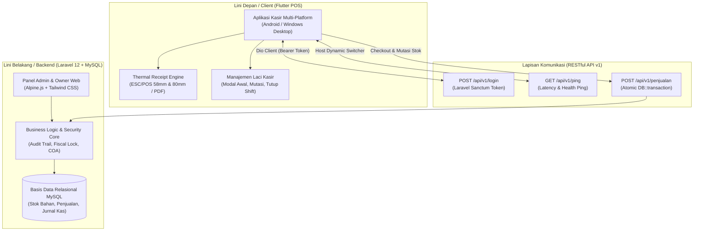

# Sistem Informasi Keuangan & Kasir POS Kedai Kopi

[](https://laravel.com)
[](https://flutter.dev)
[](https://php.net)
[](https://dart.dev)
[](https://mysql.com)
[](LICENSE)

Sistem Point of Sale (POS) kasir dan tata kelola keuangan retail terintegrasi. Mengadopsi arsitektur *decoupled client-server* yang menghubungkan antarmuka kasir multi-platform **Flutter** (Android Mobile, Tablet, dan Windows Desktop) dengan layanan REST API **Laravel 12**, dilengkapi panel administrasi web berbasis **Alpine.js**.

---

## Ikhtisar Arsitektur Sistem

Arsitektur dirancang untuk menjamin pemisahan tanggung jawab (*separation of concerns*) yang jelas antara lini depan operasional dan lini belakang akuntansi:



---

## Matriks Komponen & Teknologi

| Komponen | Direktori | Stack Teknologi | Tanggung Jawab Utama |
|---|---|---|---|
| **Client Kasir (POS)** | `mobile/` | Flutter 3, Dart, Dio, SharedPreferences | Antarmuka kasir berkecepatan tinggi, input varian menu, tiket pesanan, manajemen shift laci kasir, dan pencetakan nota thermal. |
| **Backend REST API** | `backend/` | Laravel 12, PHP 8.2+, Laravel Sanctum | Pintu gerbang API v1, penerbitan token otentikasi, validasi transaksi atomik, dan kalkulasi mutasi stok bahan otomatis. |
| **Panel Web Manajemen** | `backend/` | Blade, Alpine.js, Tailwind CSS | Dashboard operasional web, persetujuan penyesuaian stok oleh Owner, pencatatan beban operasional, dan jejak audit aktivitas. |
| **Penyimpanan Data** | Database | MySQL 8.0+ | Penyimpanan data transaksi, relasi katalog produk, riwayat belanja distributor, dan log rekonsiliasi kas. |

---

## Fitur Utama

### 1. Operasional Kasir & Antarmuka POS (Flutter)
- **Desain Industrial POS:** Mengadopsi prinsip desain *Swiss Style* dengan kartu solid berkontras tinggi (*crisp borders* 1.2px - 2.0px) tanpa efek blur yang memberatkan grafis perangkat kasir.
- **Tiket Pesanan Real-Time:** Penanganan tipe pesanan (*Dine In* / *Take Away*), input nomor meja, opsi modifier (suhu, ukuran, level gula, es, topping), dan kalkulator cepat uang kembalian.
- **Bilah Shift Terintegrasi:** Memantau jam buka shift, modal awal laci kasir, akumulasi transaksi, pencatatan kas masuk/keluar, dan verifikasi selisih kas fisik saat tutup shift.
- **Pencetakan Nota Universal:** Mendukung standar rol thermal **80 mm (POS USB/PC)**, rol kecil **58 mm (Printer Mini Bluetooth)**, dokumen **A4 / Simpan PDF**, serta pengiriman bukti transaksi digital via WhatsApp.
- **Pengalih Host Dinamis:** Tombol konfigurasi alamat server pada halaman masuk (*login*) dengan opsi preset (LAN IP, Emulator Android `10.0.2.2`, Cloudflare Tunnel) dan fitur uji latensi (*host ping*) milidetik langsung.

### 2. Finansial & Tata Kelola Korporat (Laravel 12 Backend)
- **Integritas Transaksi Atomik:** Setiap transaksi diproses di dalam `DB::transaction()` untuk menjamin pemotongan stok bahan baku dan penambahan kas berlangsung konsisten.
- **Stok Opname & Persetujuan Owner:** Penyesuaian stok dengan selisih fisik (rusak, hilang, susut) secara otomatis berstatus `menunggu_persetujuan` sebelum stok sistem dipotong.
- **Beban Operasional & Bukti Fisik:** Penomoran voucher pengeluaran kas otomatis (`BKK-YYYYMMDD-XXXXX`), pemetaan *Chart of Accounts* (COA `5-1100` s.d. `5-1900`), dan lampiran bukti kuitansi (PDF/JPG).
- **Tutup Buku (Fiscal Lock):** Mekanisme penguncian tanggal pembukuan yang menolak transaksi di masa lampau untuk menjaga integritas data akuntansi dan pelaporan pajak.
- **Enterprise Audit Trail:** Jejak audit komprehensif mencatat riwayat masuk/keluar staf, perubahan harga jual, transaksi belanja distributor, serta User-Agent perangkat.

---

## Matriks Peran & Akun Pengujian

| Peran | Saluran Akses | Batasan & Hak Akses | Akun Bawaan Seeder |
|---|---|---|---|
| **Kasir** | Flutter App (Mobile/Desktop) | Buka/tutup shift, transaksi POS, mutasi kas laci, cetak nota struk, antrean pesanan. | `kasir@example.com` / `password` |
| **Admin** | Web Dashboard | Master data menu & bahan, belanja distributor, input stok opname, catat beban operasional. | `admin@example.com` / `password` |
| **Owner** | Web Dashboard | Hak absolut: persetujuan selisih stok, ubah/hapus beban, voucher diskon, pembatalan transaksi, dan laporan laba rugi. | `owner@example.com` / `password` |

---

## Panduan Pemasangan & Menjalankan Sistem

### Kebutuhan Perangkat Lunak
- PHP >= 8.2
- Composer >= 2.x
- Basis Data MySQL
- Flutter SDK >= 3.x

---

### Langkah 1: Menyiapkan Backend Laravel

```bash
cd backend

# Salin konfigurasi lingkungan dan pasang pustaka pendukung
cp .env.example .env
composer install

# Buat kunci enkripsi aplikasi
php artisan key:generate

# Konfigurasikan koneksi basis data di berkas .env:
# DB_DATABASE=sistem_keuangan
# DB_USERNAME=root
# DB_PASSWORD=

# Jalankan migrasi skema tabel dan seeder data awal
php artisan migrate --seed

# Jalankan server lokal (dapat diakses oleh klien dalam jaringan LAN)
php artisan serve --host=0.0.0.0 --port=8000
```

> **Jalur Cepat (Windows):** Klik ganda berkas `backend/jalankan-server.bat` untuk menjalankan server secara otomatis pada alamat IP lokal perangkat Anda.

---

### Langkah 2: Menyiapkan Frontend Flutter

```bash
cd mobile

# Unduh paket dependensi Flutter
flutter pub get

# Jalankan aplikasi kasir pada perangkat yang terhubung
flutter run
```

#### Menghubungkan Kasir ke Server:
1. Buka aplikasi kasir di perangkat (HP Android, Tablet, atau PC Windows).
2. Pada layar login, pilih menu **Host API** di bagian bawah.
3. Tentukan alamat server backend:
   - **Emulator Android:** `http://10.0.2.2:8000`
   - **Perangkat Fisik (Wi-Fi LAN sama):** `http://<IP-Komputer>:8000`
   - **Luar Jaringan:** Masukkan alamat Cloudflare Tunnel dari `backend/jalankan-tunnel.bat`.
4. Tekan **Tes Koneksi** untuk memverifikasi respons server, lalu simpan.
5. Masuk menggunakan akun kasir (`kasir@example.com` / `password`).

---

### Kompilasi Paket APK Android

Untuk membangun paket instalasi APK mandiri:

```bash
cd mobile
flutter build apk --release
```

Berkas biner keluaran berada pada:  
`mobile/build/app/outputs/flutter-apk/app-release.apk`

---

## Lisensi

Proyek ini dilisensikan di bawah ketentuan [MIT License](LICENSE).
Hak Cipta (c) 2026 David Yehuda Surbakti.
